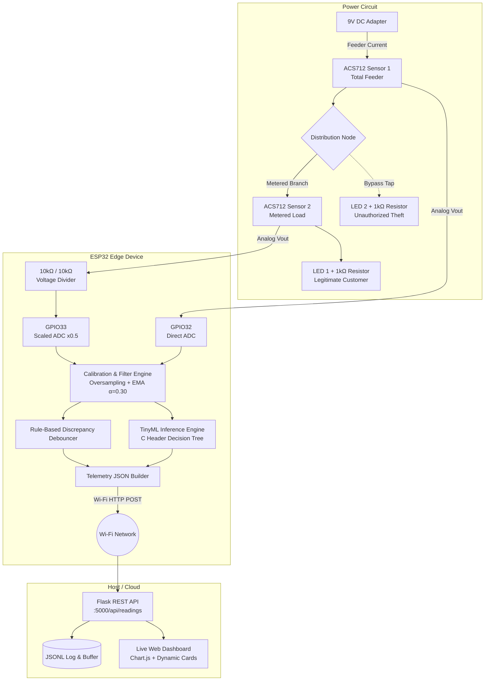

# GridGuard-AI: AI-Powered Power Theft Detection Sentinel

**GridGuard-AI** is an end-to-end IoT and TinyML prototype engineered to detect electrical power theft and bypass taps in real-time using an ESP32 microcontroller, dual ACS712 current sensors, on-device machine learning, and a live web telemetry dashboard.

---

## 1. System Architecture



---

## 2. Hardware Wiring & Breadboard Setup

### Hardware Components
1. **ESP32-WROOM DevKit** (powered via USB).
2. **Two ACS712 5A Current Sensors** (Hall-effect current transducers).
3. **Voltage Divider**: Two $10\,\text{k}\Omega$ resistors ($R_1 = 10\,\text{k}\Omega$, $R_2 = 10\,\text{k}\Omega$).
4. **9V DC Power Adapter** (supplies test circuit).
5. **Two Blue LEDs** with $1\,\text{k}\Omega$ series current-limiting resistors.
6. Breadboard, jumper wires, and optional toggle switch for bypass simulation.

### Pinout Mapping

| Component | Pin / Terminal | ESP32 Connection / Circuit Node | Purpose |
| :--- | :--- | :--- | :--- |
| **ACS712 Sensor 1** | VCC | 5V Rail (External or USB) | Sensor power supply |
| | GND | Common GND | System ground reference |
| | OUT | **GPIO32** | Direct analog readout for Total Feeder |
| | IP+ | 9V DC Adapter (+) | Incoming mains feeder line |
| | IP- | Circuit Common Node | Feeder distribution point |
| **ACS712 Sensor 2** | VCC | 5V Rail | Sensor power supply |
| | GND | Common GND | System ground reference |
| | OUT | $10\,\text{k}\Omega$ resistor to **GPIO33** | Scaled via voltage divider |
| | IP+ | Connected to Sensor 1 (IP-) | Branch entry |
| | IP- | Anode of LED 1 (via 1kΩ) | Legitimate metered branch |
| **Voltage Divider** | $R_1$ ($10\,\text{k}\Omega$) | Between Sensor 2 OUT and GPIO33 | Voltage divider high side |
| | $R_2$ ($10\,\text{k}\Omega$) | Between GPIO33 and GND | Voltage divider low side (halves voltage) |
| **Bypass Branch** | Switch / Jumper | From Sensor 1 (IP-) to LED 2 | Bypasses Sensor 2 completely |
| **Status LEDs** | GPIO2 | Onboard / External Blue LED | Flashes rapidly during active theft |
| | GPIO4 | External Blue LED | Solid ON when Wi-Fi connected |

### The Physical Bypass Arrangement
1. **Feeder Line**: The 9V DC supply passes through Sensor 1. Sensor 1 measures the **entire system current** ($I_{\text{total}}$).
2. **Metered Branch**: Passes through Sensor 2 into LED 1 ($1\,\text{k}\Omega$ resistor). Sensor 2 measures **legitimate consumption** ($I_{\text{metered}}$).
3. **Bypass Branch**: Connects directly from the output of Sensor 1 to LED 2, **bypassing Sensor 2**.
   - **Normal State** (Bypass switch OPEN): $I_{\text{total}} \approx I_{\text{metered}}$. Discrepancy $\Delta I \approx 0\,\text{A}$.
   - **Theft State** (Bypass switch CLOSED): Current splits. Sensor 1 measures $I_{\text{metered}} + I_{\text{bypass}}$. Sensor 2 only measures $I_{\text{metered}}$. Discrepancy $\Delta I = I_{\text{total}} - I_{\text{metered}} \approx I_{\text{bypass}} > 35\,\text{mA}$.
   - **Power Loss State** (9V Adapter OFF): $I_{\text{total}} \approx 0\,\text{A}$ and $I_{\text{metered}} \approx 0\,\text{A}$.

---

## 3. Sensor Calibration & Signal Processing

### 1. Voltage Divider Compensation on GPIO33
The ACS712-05B operates at 5V $V_{CC}$ and outputs $V_{CC}/2 \approx 2.50\,\text{V}$ at zero current, with a swing up to 5V. Because the ESP32 ADC maximum recommended linear range is $\approx 3.1\,\text{V}$ (11dB attenuation), Channel 2 incorporates a $10\,\text{k}\Omega / 10\,\text{k}\Omega$ divider:
$$V_{\text{pin33}} = V_{\text{sensor2}} \times \frac{R_2}{R_1 + R_2} = V_{\text{sensor2}} \times 0.50$$
To reconstruct the true sensor voltage:
$$V_{\text{sensor2}} = V_{\text{pin33}} \times 2.000$$

### 2. Zero-Current Offset Calibration (Tare)
Due to manufacturing tolerances and temperature drift, sensors do not output exactly 2.500V. At startup, `calibrate_sensors()` acquires 400 samples across both channels with no load to establish independent baselines:
$$V_{\text{zero1}} = \frac{1}{N} \sum_{i=1}^N V_{\text{pin32}}[i]$$
$$V_{\text{zero2}} = \frac{1}{N} \sum_{i=1}^N (V_{\text{pin33}}[i] \times 2.0)$$

### 3. Current Estimation in Amperes
Nominal sensitivity for the ACS712-05B is $185\,\text{mV/A}$ ($0.185\,\text{V/A}$):
$$I_1 = \frac{V_{\text{pin32}} - V_{\text{zero1}}}{0.185\,\text{V/A}}$$
$$I_2 = \frac{(V_{\text{pin33}} \times 2.0) - V_{\text{zero2}}}{0.185\,\text{V/A}}$$

### 4. Noise Mitigation & Filtering
1. **Oversampling**: 120 consecutive ADC samples averaged per measurement cycle.
2. **Exponential Moving Average (EMA)**:
   $$\bar{I}_t = \alpha \cdot I_{\text{raw}} + (1 - \alpha) \cdot \bar{I}_{t-1} \quad (\alpha = 0.30)$$
3. **Residual Noise Clamp**: Small noise below $6\,\text{mA}$ is clamped to prevent baseline wander.

---

## 4. Machine Learning & Random Forest Inference Pipeline

GridGuard-AI utilizes a server-side **Random Forest Classifier** trained on rolling statistical features extracted from dual-channel ADC signals:

### Rolling Window Features (Window Size $W = 5$ samples)
1. `mean_total_adc`: Rolling mean of Feeder ADC readings (GPIO32).
2. `mean_metered_adc`: Rolling mean of Metered ADC readings (GPIO33).
3. `mean_delta_total`: Rolling mean of Feeder offset from zero-load baseline tare.
4. `mean_delta_metered`: Rolling mean of Metered offset from zero-load baseline tare.
5. `delta_diff`: `mean_delta_total - mean_delta_metered` (primary discrepancy signal).
6. `std_total_adc`: Standard deviation of Feeder signal in window (motor brush commutator noise signature).
7. `std_metered_adc`: Standard deviation of Metered signal in window.

### Session-Level Held-Out Evaluation (No Data Leakage)
Models are split strictly by independent recording session using `GroupShuffleSplit`. Samples from the same recording session never span train and test sets.

```
Model Artifacts:
├── model/random_forest.joblib      # Trained Random Forest model (50 trees, max_depth=6)
├── model/feature_config.json      # Feature order, class mappings, window size
└── model/evaluation_report.json   # Precision, recall, F1, confusion matrix
```

---

## 5. Real Sensor Data Collection Workflow

To record hardware baseline and theft sessions directly from the ESP32:

```bash
# Connect ESP32 via USB and run collector
python scripts/collect_sensor_data.py --port COM3 --baud 115200
```

1. Select **[1] NORMAL** (LED ON, Motor OFF) or **[2] POSSIBLE_THEFT** (LED ON, Motor ON bypassing Sensor 2).
2. Confirm the physical circuit state before recording starts.
3. Records are automatically streamed and appended to `data/sensor_readings.csv`.
4. Retrain the Random Forest model on hardware data:
   ```bash
   python ml/train_random_forest.py
   ```

---

## 6. End-to-End Demonstration Checklist

### Test A: NORMAL
1. Keep the LED ON and Motor OFF.
2. ESP32 transmits baseline readings (`delta_total ≈ delta_metered`).
3. Flask aggregates 5 rolling samples and Random Forest classifies **`NORMAL`** (Model Score ~ 99%).
4. Dashboard displays green "NORMAL" badge and balanced discrepancy.

### Test B: POSSIBLE_THEFT
1. Switch the motor ON (bypassing Sensor 2).
2. Feeder sensor (GPIO32) registers an immediate jump (+80 to +120 ADC counts).
3. Metered sensor (GPIO33) remains steady at the LED load.
4. Flask detects discrepancy `delta_diff > 70 ADC`, Random Forest flags **`POSSIBLE_THEFT`**.
5. Dashboard turns red, activates pulsating warning banner and alert chirp.

### Test C: RETURN TO NORMAL
1. Switch the motor OFF.
2. Feeder sensor returns to LED-only baseline.
3. Feature window clears in $W=5$ cycles, Random Forest smoothly transitions back to **`NORMAL`**.

---

## 7. Quickstart Guide

### 1. Install Dependencies
```bash
pip install -r backend/requirements.txt
```

### 2. Run Integration Tests
```bash
pytest -v tests
```
*(All 15 unit and integration tests validate the ADC schema, feature extraction, warmup buffering, model loading, and debouncing).*

### 3. Start the Flask Backend & Dashboard
```bash
python backend/app.py
```
Open **`http://localhost:5000/`** in your browser.

### 4. Run Demonstration Simulator
```bash
python simulation/esp32_simulator.py --mode demo
```

### 5. Flash Firmware to ESP32
1. In `firmware/config.h`, set your Wi-Fi credentials (`WIFI_SSID`, `WIFI_PASSWORD`).
2. Verify target IP is your laptop's Wi-Fi LAN address (e.g. `http://172.18.117.43:5000/api/readings`).
3. Flash `firmware/gridguard_esp32.ino` using Arduino IDE.

